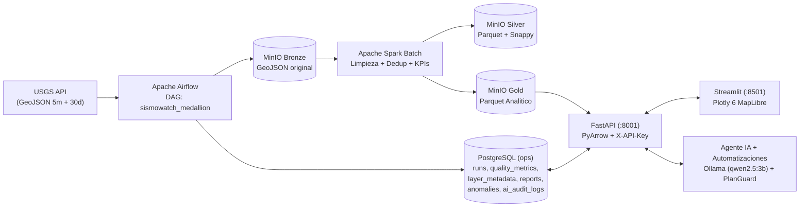

# SismoWatch

- **Autor:** Kevin Escorcia (`@KevinLise`)
- **Repositorio Oficial en GitHub:** [https://github.com/KevinLise/Prueba_D_Kevin](https://github.com/KevinLise/Prueba_D_Kevin)
- **Clonar repositorio:** `git clone https://github.com/KevinLise/Prueba_D_Kevin.git`

SismoWatch procesa el catalogo publico de sismos de USGS con una arquitectura **Medallion** y procesamiento **Batch**:

```text
USGS API -> Airflow -> MinIO Bronze -> Spark Batch -> MinIO Silver -> MinIO Gold
         -> FastAPI (lectura Gold con PyArrow) -> Streamlit + agente IA
         -> PostgreSQL operativo (ops): ejecuciones, calidad, usuarios y configuracion
```

No usa Kafka, Spark Structured Streaming, Delta Lake ni DuckDB.
PostgreSQL **no** contiene los esquemas `raw`, `staging` ni `curated`.

---

## 1. Estado de validacion

| Elemento | Estado |
|---|---|
| Compilacion Python | Correcta. |
| Pruebas unitarias | 41 pasaron, 1 omitida por falta de `pyspark` en el Python local. |
| `docker compose config` | Correcto. |
| Contenedores | Iniciados y saludables. |
| Imagenes Docker | Descargadas y construidas. |
| Ingesta real USGS | Ejecutada. |
| Spark Batch real | Ejecutado. |
| Spark-MinIO | Validado con datos reales. |
| API leyendo Gold con PyArrow | Validada. |
| API y dashboard | Ejecutados; dashboard HTTP 200 (Plotly 6 MapLibre + tema oscuro). |
| Migraciones `003_pipeline_metadata.sql` y `004_ai_subsystem.sql` | Aplicadas sobre la base actual (`ops`). |
| Endpoints de metadatos | Verificados con datos reales. |
| Ejecucion fallida controlada | Verificada en `ops.runs` sin afectar las capas sismicas. |
| Agente IA (Ollama `qwen2.5:3b` + fallback determinista) | Probado de punta a punta con datos reales, informe diario, anomalias y auditoria. |

El flujo principal fue validado con una ejecucion real: 2.033 registros Bronze, 1.998 Silver, 35 duplicados, 0 invalidos y 98,28% de calidad.

---

## 2. Arquitectura



```text
                         USGS
                          |
                          v
                  +---------------+
                  |   Airflow     |
                  | cada 5 min    |
                  | historico 30d |
                  +-------+-------+
                          |
                          v
              +-----------------------+
              | MinIO Bronze          |
              | GeoJSON original      |
              +-----------+-----------+
                          |
                    Spark Batch
                          |
              +-----------v-----------+
              | MinIO Silver          |
              | Parquet + dedup       |
              +-----------+-----------+
                          |
                    Spark Batch
                          |
              +-----------v-----------+
              | MinIO Gold            |
              | agregados + calidad   |
              +-----------+-----------+
                          |
             +------------+----------------+
             |                             |
             v                             v
   API (PyArrow sobre Gold)       PostgreSQL operativo
   endpoints de solo lectura      ops.runs, ops.load_control,
             |                    ops.quality_metrics, usuarios,
             v                    roles y configuracion
   Streamlit + agente IA
```

### Responsabilidades

| Componente | Responsabilidad |
|---|---|
| USGS | Fuente publica de eventos recientes e historicos. |
| Apache Airflow | Orquesta ingesta, Spark, verificacion y metricas cada 5 minutos. |
| Apache Spark Batch | Valida, normaliza, deduplica y agrega. |
| MinIO | Guarda Bronze (GeoJSON), Silver (Parquet) y Gold (Parquet). |
| PostgreSQL `sismowatch-db` | Solo datos operativos en el esquema `ops`. |
| PostgreSQL `airflow-db` | Solo metadatos internos de Airflow. |
| FastAPI | Backend de consulta; lee Gold desde MinIO y `ops` desde PostgreSQL. |
| Streamlit | Dashboard que consume la API. |
| Agente IA | Planes de consulta validados y de solo lectura sobre Gold. |

---

## 3. Estructura

```text
.
├── docker-compose.yml
├── .env.example
├── .streamlit/
│   └── config.toml
├── config/settings.py
├── ingest/
│   ├── usgs_client.py
│   ├── storage.py
│   ├── paths.py
│   ├── ingest_recent.py
│   └── ingest_historical.py
├── spark_jobs/
│   ├── pure.py
│   ├── common.py
│   └── batch_job.py
├── dags/sismowatch_batch_dag.py
├── pipeline/
│   ├── gold_store.py
│   ├── verify_gold.py
│   └── record_metrics.py
├── db/
│   ├── init/001_schema.sql
│   ├── migrations/002_drop_legacy_schemas.sql
│   ├── migrations/003_pipeline_metadata.sql
│   ├── migrations/004_ai_subsystem.sql
│   ├── connection.py
│   └── runs.py
├── api/
│   ├── app.py
│   └── queries.py
├── dashboard/
│   ├── app.py
│   └── api_client.py
├── agent/
│   ├── agent.py
│   ├── plan_guard.py
│   ├── reports.py
│   ├── anomalies.py
│   └── audit.py
├── tests/
├── docker/
│   ├── airflow.Dockerfile
│   ├── api.Dockerfile
│   ├── minio-init.Dockerfile
│   └── streamlit.Dockerfile
└── docs/
    ├── ARQUITECTURA.md
    ├── FLUJO_DATOS.md
    ├── INDICADORES_Y_GRAFICOS.md
    ├── IA_Y_AUTOMATIZACIONES.md
    ├── MANUAL_OPERACION.md
    └── PRESENTACION_ACADEMICA.md
```

### 3.1. Documentacion tecnica detallada (`docs/`)

| Documento | Contenido principal |
|---|---|
| [`docs/ARQUITECTURA.md`](docs/ARQUITECTURA.md) | Documentacion exhaustiva de cada tecnologia, diagrama general Mermaid y tabla de justificacion arquitectonica. |
| [`docs/FLUJO_DATOS.md`](docs/FLUJO_DATOS.md) | Recorrido de un evento sismico en 10 etapas, tolerancia a fallos, idempotencia y diagramas de secuencia (ETL, DAG, Agente IA y Reporte Diario). |
| [`docs/INDICADORES_Y_GRAFICOS.md`](docs/INDICADORES_Y_GRAFICOS.md) | Formulas matematicas, unidades, origenes, ejemplos numericos reales e interpretacion de cada KPI y grafico del dashboard. |
| [`docs/IA_Y_AUTOMATIZACIONES.md`](docs/IA_Y_AUTOMATIZACIONES.md) | Configuracion de Ollama (`qwen2.5:3b`), regla anti-alucinacion, por que no se usa RAG, Informe Narrativo Diario, Deteccion de Anomalias (Z-Score) y Auditoria IA. |
| [`docs/MANUAL_OPERACION.md`](docs/MANUAL_OPERACION.md) | Guia paso a paso de instalacion, `.env`, Docker Compose, verificacion de PostgreSQL/MinIO/Spark/Airflow/Ollama, pruebas y resolucion de problemas. |
| [`docs/PRESENTACION_ACADEMICA.md`](docs/PRESENTACION_ACADEMICA.md) | Guia completa de defensa academica para Ingenieria de Sistemas y banco de preguntas y respuestas de sustentacion. |

---

## 4. MinIO: capas de datos

Bucket unico: `sismowatch`.

```text
sismowatch/bronze/source=usgs/kind=recent/ingest_date=YYYY-MM-DD/
sismowatch/bronze/source=usgs/kind=historical/ingest_date=YYYY-MM-DD/
sismowatch/silver/events/event_date=YYYY-MM-DD/
sismowatch/gold/daily_activity/
sismowatch/gold/magnitude_distribution/
sismowatch/gold/top_places/
sismowatch/gold/top_regions/
sismowatch/gold/summary/
sismowatch/gold/events/
sismowatch/gold/data_quality/
```

- Bronze conserva el GeoJSON original.
- Silver es Parquet limpio, validado y deduplicado.
- Gold contiene agregados y el dataset `events` para el mapa.
- `data_quality` registra conteos y frescura de la ultima ejecucion.
- No existe cuarentena.

Los formatos procesados usan Parquet con compresion Snappy.

---

## 5. PostgreSQL operativo

La base `sismowatch-db` contiene solo el esquema `ops`. No se crean `raw`, `staging` ni `curated`.

| Tabla | Uso |
|---|---|
| `ops.runs` | Ejecuciones, estado, duracion, errores y conteos. |
| `ops.load_control` | Marca de carga historica completada. |
| `ops.quality_metrics` | Metricas de calidad por ejecucion. |
| `ops.app_users` | Usuarios operativos de la aplicacion. |
| `ops.app_roles` | Roles (`admin`, `analyst`, `viewer`). |
| `ops.app_user_roles` | Relacion usuario-rol. |
| `ops.app_config` | Configuracion no secreta de la aplicacion. |
| `ops.daily_reports` | Informes narrativos diarios validados con Pydantic y metricas reales. |
| `ops.anomalies` | Anomalias estadisticas detectadas por z-score y picos de magnitud. |
| `ops.ai_audit_logs` | Auditoria de modelo, version de prompt, latencia, tokens reales y fallback. |

La base `airflow-db` se mantiene separada y solo guarda metadatos de Airflow.

### Migracion desde los esquemas anteriores

Si la base ya existia con `raw`, `staging` y `curated`:

1. Haz backup.
2. Aplica `db/init/001_schema.sql` sobre la base existente. Usa `CREATE ... IF NOT EXISTS`, por lo que crea `ops` sin borrar lo anterior.
3. Verifica que la API, el dashboard y Airflow ya no consultan los esquemas antiguos.
4. Aplica la migracion aditiva `db/migrations/003_pipeline_metadata.sql`.
5. Revisa el inventario con `db/migrations/002_drop_legacy_schemas.sql`.
6. Solo con autorizacion explicita, descomenta los `DROP SCHEMA` y ejecuta la migracion.

Detalle completo en `db/migrations/README.md`. **No se ejecuto ninguna migracion destructiva.**

---

## 5.1 Metadatos del pipeline

Los metadatos operativos se guardan en PostgreSQL, no en las capas sismicas de MinIO.

| Tabla | Campos principales |
|---|---|
| `ops.runs` | `run_id`, `airflow_run_id`, inicio, fin, duracion, estado, `current_stage`, `records_received`, `records_processed`, `last_data_update`, error. |
| `ops.quality_metrics` | Bronze, validos, invalidos, duplicados, Silver, `last_event_time`, frescura y `quality_percentage`. |
| `ops.layer_metadata` | Una fila por `run_id` y capa (`bronze`, `silver`, `gold`) con estado, conteos, ruta, formato, rango temporal y `details` JSONB. |

### Porcentaje de calidad

Formula implementada:

```text
quality_percentage = (valid_records - duplicate_records) / bronze_records * 100
```

Si `bronze_records` es cero, el porcentaje es `0.0` para evitar division entre cero. El resultado se limita al rango 0-100 y se redondea a dos decimales.

### Reintentos e idempotencia

El `run_id` se deriva de forma determinista del `run_id` de Airflow (`uuid5`). Un reintento reutiliza la misma fila de `ops.runs` y actualiza su estado, en lugar de crear otra ejecucion. Spark mantiene la deduplicacion por `id` USGS.

### Verificacion con datos reales

- Endpoints `GET /api/v1/metadata/summary`, `/runs`, `/quality` y `/layers` respondieron correctamente.
- Ultima ejecucion exitosa verificada: `dae07d2c-79c5-57c7-a4ab-dc832974f965`.
- Bronze: 2.033 registros; Silver: 1.998; duplicados: 35; invalidos: 0; calidad: 98,28%.
- Metadatos Bronze, Silver y Gold registrados en `ops.layer_metadata`.

---

## 6. Variables de entorno

```bash
cp .env.example .env
```

| Variable | Uso |
|---|---|
| `MINIO_ROOT_USER`, `MINIO_ROOT_PASSWORD` | Servidor MinIO. |
| `MINIO_ACCESS_KEY`, `MINIO_SECRET_KEY` | Aplicaciones. Deben coincidir con las anteriores en local. |
| `MINIO_BUCKET` | Bucket unico Medallion. |
| `MINIO_ENDPOINT`, `MINIO_ENDPOINT_HOST`, `MINIO_SECURE` | Endpoint interno. |
| `AIRFLOW_DB_PASSWORD` | Metadatos de Airflow. |
| `AIRFLOW_ADMIN_USER`, `AIRFLOW_ADMIN_PASSWORD`, `AIRFLOW_ADMIN_EMAIL` | Usuario de Airflow. |
| `SISMOWATCH_DB_HOST`, `SISMOWATCH_DB_PORT`, `SISMOWATCH_DB_NAME` | Base operativa. |
| `SISMOWATCH_DB_USER`, `SISMOWATCH_DB_PASSWORD` | Credenciales de la base operativa. |
| `USGS_MIN_MAGNITUDE` | Magnitud minima del historico. |
| `HISTORICAL_DAYS` | Dias de la carga historica (30). |
| `USGS_TIMEOUT_SECONDS` | Timeout de USGS. |
| `SPARK_MASTER_URL` | Master de Spark. |
| `SISMOWATCH_API_URL` | URL de la API para el dashboard. |
| `API_KEY` | API key opcional para `/api/v1/*`. |
| `AGENT_LLM_API_KEY`, `AGENT_LLM_BASE_URL`, `AGENT_LLM_MODEL` | LLM opcional de la API. |

No subas `.env` al repositorio.

---

## 7. Inicio

```bash
docker compose config --quiet
docker compose build
docker compose up -d
docker compose ps
```

Primera ejecucion:

```bash
docker compose logs -f airflow-init
docker compose logs -f sismowatch-db
docker compose logs -f api
```

| Servicio | URL |
|---|---|
| Airflow | http://localhost:8080 |
| API / Swagger | http://localhost:8001/docs |
| Dashboard | http://localhost:8501 |
| MinIO Console | http://localhost:9001 |
| Spark Master UI | http://localhost:8082 |

### Imagenes base

| Imagen | Uso |
|---|---|
| `pgsty/silo:latest` | Servidor S3 compatible con MinIO. Las imagenes oficiales `minio/minio` ya no se publican. |
| `sismowatch-minio-init:local` | Imagen construida con Python + boto3 para crear el bucket. |
| `apache/spark:3.5.1` | Spark Master y Worker con comandos explicitos. |
| `apache/airflow:2.9.3-python3.11` | Base de Airflow. |
| `postgres:16-alpine` | Airflow y PostgreSQL operativo. |
| `python:3.11-slim` | Base de API, dashboard e inicializador. |

Las variables `MINIO_*`, las rutas S3 y la API siguen siendo compatibles. Silo es un fork mantenido de MinIO, no la imagen oficial.

Si una imagen no aparece, actualiza y vuelve a descargar:

```bash
docker compose pull
docker compose build --pull
docker compose up -d
```

La API usa el puerto interno 8000 y se publica en el host como 8001. Si ejecutas Streamlit fuera de Docker, configura `SISMOWATCH_API_URL=http://localhost:8001`.

---

## 8. Carga historica y DAG

El DAG `sismowatch_medallion` se ejecuta cada cinco minutos:

```text
bootstrap_history
  -> ingest_recent
  -> run_spark_batch
  -> verify_gold
  -> record_metrics
```

- `bootstrap_history`: si `ops.load_control` no tiene `historical_30d`, descarga los ultimos 30 dias.
- `ingest_recent`: consulta el feed de USGS y escribe Bronze.
- `run_spark_batch`: transforma Bronze a Silver y Gold.
- `verify_gold`: verifica Parquet Gold en MinIO.
- `record_metrics`: lee `gold/data_quality` y registra estado y metricas en `ops`.

Activar y disparar:

```bash
docker compose exec airflow-scheduler airflow dags unpause sismowatch_medallion
docker compose exec airflow-scheduler airflow dags trigger sismowatch_medallion
```

Carga historica manual:

```bash
docker compose exec airflow-scheduler python -m ingest.ingest_historical \
  --start 2026-09-27 --end 2026-10-27
```

Para repetir la carga historica automatica:

```bash
docker compose exec sismowatch-db psql -U sismowatch -d sismowatch -c \
  "DELETE FROM ops.load_control WHERE load_name = 'historical_30d';"
```

---

## 9. API y dashboard

La API lee los Parquet Gold desde MinIO con PyArrow. El navegador nunca recibe credenciales de MinIO. El dashboard solo consume la API.

| Endpoint | Funcion |
|---|---|
| `GET /health` | Estado de PostgreSQL y Gold. |
| `GET /api/v1/summary` | Indicadores generales. |
| `GET /api/v1/events` | Eventos con filtros. |
| `GET /api/v1/daily-activity` | Evolucion diaria. |
| `GET /api/v1/magnitude-distribution` | Distribucion por magnitud. |
| `GET /api/v1/top-places` | Lugares con mas actividad. |
| `GET /api/v1/top-regions` | Regiones con mas actividad. |
| `GET /api/v1/quality` | Metricas operativas de calidad. |
| `GET /api/v1/runs` | Ejecuciones recientes. |
| `GET /api/v1/metadata/summary` | Resumen de la ultima ejecucion, calidad y capas. |
| `GET /api/v1/metadata/runs` | Historial de ejecuciones con etapa y conteos. |
| `GET /api/v1/metadata/quality` | Historial de metricas de calidad. |
| `GET /api/v1/metadata/layers` | Estado de Bronze, Silver y Gold. |
| `GET /api/v1/agent/suggestions` | Preguntas frecuentes sugeridas para el agente. |
| `POST /api/v1/agent/query` | Agente conversacional de solo lectura (Ollama + fallback determinista). |
| `GET /api/v1/reports` | Historial de informes narrativos diarios (`ops.daily_reports`). |
| `POST /api/v1/reports/generate` | Genera/actualiza el informe diario con validacion Pydantic (`admin`/`analyst`). |
| `GET /api/v1/reports/export` | Exporta el informe diario en formato `md`, `json` o `csv`. |
| `GET /api/v1/anomalies` | Anomalias estadisticas detectadas (`ops.anomalies`). |
| `POST /api/v1/anomalies/detect` | Ejecuta deteccion estadistica de anomalias (`admin`/`analyst`). |
| `GET /api/v1/ai-audit` | Auditoria de llamadas al modelo IA (`ops.ai_audit_logs`). |

Ejemplos:

```bash
curl http://localhost:8001/health
curl -H "X-API-Key: $API_KEY" http://localhost:8001/api/v1/summary
curl -H "X-API-Key: $API_KEY" "http://localhost:8001/api/v1/events?limit=10&min_magnitude=4"
```

Si `API_KEY` esta vacia, omite la cabecera.

### Dashboard: mapa de epicentros

- Usa Plotly 6 (`px.scatter_map`) con MapLibre y el estilo oscuro `carto-darkmatter`.
- Vista inicial centrada en América Latina y el Caribe, con zoom interactivo.
- Los filtros laterales de región y lugar alimentan el mapa y la tabla inferior.
- Los marcadores conservan la escala de color por magnitud.
- El popup muestra magnitud, ubicación, profundidad, fecha y región.
- El mapa requiere conexión a internet para cargar las teselas cartográficas.

### Dashboard: monitoreo del pipeline

La pestana **Monitoreo** muestra:

- Estado y etapa de la ultima ejecucion.
- Ultima actualizacion y duracion.
- Registros recibidos, procesados, duplicados e invalidos.
- Porcentaje de calidad.
- Estado de Bronze, Silver y Gold.
- Historial de ejecuciones y errores.

Los datos provienen de la API (`ops.runs`, `ops.quality_metrics` y `ops.layer_metadata`), no de valores de ejemplo.

### Subsistema de IA (Agente Ollama, Informe Diario, Anomalias y Auditoria)

- **Configuracion de Ollama:** Se configura con `OLLAMA_BASE_URL` (por ejemplo `http://host.docker.internal:11434`), `OLLAMA_MODEL` (`qwen2.5:3b`) y `OLLAMA_TIMEOUT` (`45`). Para instalar el modelo en el host: `ollama pull qwen2.5:3b`.
- **Regla anti-alucinacion:** Todas las cifras (conteos en 24h, magnitud maxima en 30d, regiones mas activas, variacion semanal, estado del pipeline y registros rechazados por calidad) se calculan mediante Python/SQL sobre Gold y `ops`. Ollama redacta la respuesta en espanol a partir de esas estadisticas y se valida que no contradiga las cifras reales; si Ollama no esta disponible o falla la validacion, actua el fallback determinista local (`mode="reglas"`).
- **Automatizacion 1 — Informe narrativo diario (`agent/reports.py`):** Integrado en `record_metrics` del DAG y expuesto en `/api/v1/reports`. Sanitiza textos externos (`place`, `region`), utiliza prompt versionado (`report-v1.0`), valida la salida estructurada con Pydantic (`NarrativeReportSchema`), verifica coherencia numerica frente a los datos reales y persiste con UPSERT en `ops.daily_reports`. Soporta exportacion real en Markdown (`.md`), JSON (`.json`) y CSV (`.csv`).
- **Automatizacion 2 — Deteccion estadistica de anomalias (`agent/anomalies.py`):** Calcula z-score sobre conteos por ventana diaria/horaria y picos de magnitud (`>= 6.0`) con minimo de periodos base, guardando de forma idempotente en `ops.anomalies` y aclarando explicitamente que se trata de una anomalia estadistica observada y no de una prediccion de terremotos.
- **Auditoria de IA (`agent/audit.py`):** Registra en `ops.ai_audit_logs` modelo, version de prompt, modo, estado, latencia y tokens reales devueltos por el proveedor (`prompt_eval_count`, `eval_count`) sin inventar metricas.

---

## 10. Pruebas

```bash
python3 -m venv .venv
source .venv/bin/activate
pip install -r requirements-dev.txt
pytest -q
```

Resultado en este entorno:

```text
41 passed, 1 skipped
```

La prueba omitida es la de Spark, porque `pyspark` no esta instalado en el Python del sistema.

Cubren:

- Normalizacion, validacion, region textual y deduplicacion.
- Formula de porcentaje de calidad, incluida la division entre cero.
- Cliente USGS y rutas Bronze.
- Planes de consulta seguros del agente.
- Contrato de metadatos PostgreSQL (`ops.runs`, `ops.quality_metrics`, `ops.layer_metadata`).
- Contrato del esquema operativo sin `raw`, `staging` ni `curated`.
- Contrato de Compose sin Kafka, Streaming ni DuckDB.

La suite automatizada no incluye pruebas de integracion. Se hicieron verificaciones manuales con contenedores:

- Ejecucion real exitosa del DAG con Bronze, Silver y Gold.
- 2.033 registros Bronze, 1.998 Silver, 35 duplicados, 0 invalidos y 98,28% de calidad.
- `GET /api/v1/metadata/summary`, `/runs`, `/quality` y `/layers` con respuesta correcta.
- Ejecucion fallida controlada registrada con estado `failed` y etapa `verification`.
- Dashboard renderizado con `AppTest`: pestana Monitoreo, metricas reales y 98,28% de calidad.

---

## 11. Servicios

### Agregados

- `sismowatch-db`: PostgreSQL operativo (`ops`).
- `api`: FastAPI que lee Gold desde MinIO.

### Eliminados

- `kafka`, `kafka-init`, `producer`, `streaming`.
- `spark_jobs/streaming_job.py`, `ingest/recent_producer.py`.
- `db/publish.py` y la publicacion staging a curated.
- DuckDB y Delta Lake.
- La imagen `ingest`.

---

## 12. Solucion de problemas

### Airflow no arranca

```bash
docker compose logs airflow-db
docker compose logs airflow-init
docker compose logs airflow-webserver
```

### Spark falla

```bash
docker compose logs airflow-scheduler
docker compose logs spark-master
docker compose logs spark-worker
```

Causas frecuentes: falta de internet para `hadoop-aws`, credenciales de MinIO incorrectas, Spark worker no disponible o ruta Bronze inexistente.

### La API no puede leer Gold

- Revisa que MinIO tenga objetos en `sismowatch/gold/`.
- Revisa `MINIO_ENDPOINT_HOST`, credenciales y `MINIO_SECURE`.
- Comprueba `curl http://localhost:8001/health`.
- PyArrow debe tener soporte S3; la imagen instala `pyarrow`.

### El dashboard no muestra datos

- Verifica que el DAG termino.
- Revisa `ops.runs` y `ops.quality_metrics`.
- Comprueba `gold/data_quality` en MinIO.
- El estado final esperado de una ejecucion correcta es `completed` en `ops.runs`.

### PostgreSQL tenia raw/staging/curated

No los borres automaticamente. Sigue `db/migrations/README.md`, haz backup y ejecuta la migracion solo con autorizacion.

---

## 13. Seguridad y limitaciones

- No hay secretos en el codigo; se leen de `.env`.
- `.env` esta ignorado por Git.
- MinIO local no usa TLS por defecto.
- La API usa API key opcional; no hay autenticacion de usuarios completa.
- El agente solo ejecuta planes validados de lectura.
- No hay catalogo ni linaje.
- No hay alertas.
- No se valido el flujo end-to-end.
- La region es un texto derivado de `place`, no un pais estructurado.
- La carga historica de 30 dias se hace en una sola consulta; si USGS limita el resultado, se debe paginar.
- La marca `historical_30d` asume que los objetos Bronze historicos siguen en MinIO.
- Una ejecucion reciente de Spark fue reintentada con codigo -9, probablemente por presion de memoria del entorno local. No afecta los metadatos ya registrados, pero conviene ajustar recursos si se repite.
- Las tablas `ops.app_users`/roles estan preparadas para una autenticacion futura; la API sigue usando `API_KEY`.

Para produccion se requieren TLS, gestor de secretos, autenticacion fuerte, backups, monitoreo, linaje, paginacion y pruebas de integracion.
