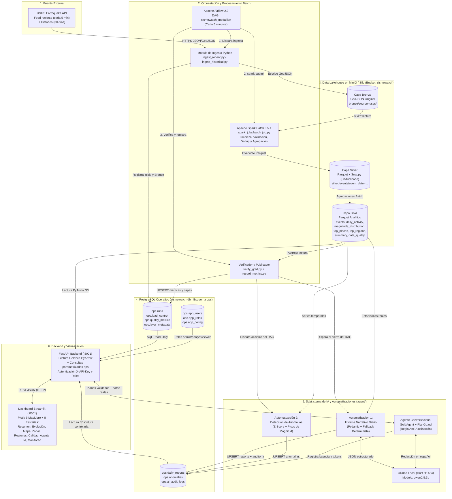

# Arquitectura Técnica y Justificación de SismoWatch

## 1. Visión General de la Arquitectura

**SismoWatch** es una plataforma de ingeniería de datos e inteligencia artificial aplicada al monitoreo y análisis sísmico a partir del catálogo público del **United States Geological Survey (USGS)**.

El sistema implementa una arquitectura **Medallion (Bronze → Silver → Gold)** con procesamiento **Batch** orquestado cada 5 minutos por **Apache Airflow**, transformaciones distribuidas con **Apache Spark Batch**, almacenamiento de objetos compatible con S3 en **MinIO (Silo)**, persistencia operativa en **PostgreSQL (esquema `ops`)**, una capa de servicio **FastAPI** de solo lectura sobre los datos sísmicos, un **subsistema de IA con Ollama (`qwen2.5:3b`)** con validación anti-alucinación y un dashboard interactivo en **Streamlit + Plotly 6 (MapLibre)**.

> **Nota de fidelidad arquitectónica:**
> - Los datos sísmicos viven exclusivamente en las capas **Bronze (GeoJSON)**, **Silver (Parquet)** y **Gold (Parquet)** dentro de MinIO.
> - PostgreSQL (`sismowatch-db`) almacena **únicamente** metadatos operativos, métricas de calidad, informes diarios, anomalías estadísticas, auditoría de IA y control de acceso en el esquema `ops`. No existen los esquemas antiguos `raw`, `staging` ni `curated`.
> - El frontend del proyecto está construido en **Streamlit** (`dashboard/app.py`), no en React.
> - No se utilizan Kafka, Spark Structured Streaming, Delta Lake, DuckDB ni bases vectoriales (RAG).

---

## 2. Diagrama General de Arquitectura (Mermaid)

---

## 3. Documentación Detallada de Cada Tecnología

A continuación se documentan únicamente las herramientas realmente implementadas y verificadas en el repositorio.

### 3.1 Catálogo Sísmico de USGS (Fuente de Datos)
- **Qué es:** Servicio público del Servicio Geológico de Estados Unidos que expone eventos sísmicos globales en formato GeoJSON mediante API REST y feeds actualizados.
- **Para qué sirve en SismoWatch:** Provee tanto la carga histórica inicial de los últimos 30 días como el flujo incremental reciente cada 5 minutos.
- **Por qué se eligió frente a alternativas:** Es el estándar internacional abierto, no requiere clave de pago, entrega coordenadas tridimensionales (latitud, longitud, profundidad), magnitud, indicador de tsunami y marca de actualización (`updated`) con identificadores únicos globales (`id`).
- **Qué problema resuelve:** Elimina la necesidad de simular datos sísmicos, permitiendo operar sobre sismos reales en tiempo cuasi-real.
- **Qué datos recibe y qué produce:**
  - *Recibe:* Parámetros HTTP (`starttime`, `endtime`, `minmagnitude=2.5`, `format=geojson`) en el endpoint histórico, o solicitud GET directa al feed `all_hour.geojson`.
  - *Produce:* Un objeto `FeatureCollection` GeoJSON donde cada elemento `feature` contiene `id`, `properties` (`mag`, `place`, `time`, `updated`, `tsunami`, `sig`, `status`, `magType`, `type`, `url`) y `geometry.coordinates` (`[longitud, latitud, profundidad_km]`).
- **Con qué componentes se comunica:** Con el módulo de ingesta Python (`ingest/usgs_client.py`) invocado desde Airflow.
- **Archivos de implementación:** [`ingest/usgs_client.py`](file:///home/cohorte5/Documentos/Prueba_Kevin/ingest/usgs_client.py), [`ingest/ingest_recent.py`](file:///home/cohorte5/Documentos/Prueba_Kevin/ingest/ingest_recent.py), [`ingest/ingest_historical.py`](file:///home/cohorte5/Documentos/Prueba_Kevin/ingest/ingest_historical.py).
- **Cómo se ejecuta y comprueba:** Se ejecuta automáticamente en el DAG o manualmente con `docker compose exec airflow-scheduler python -m ingest.ingest_recent`.
- **Limitaciones y qué sucede si falla:** Requiere conexión a internet y puede aplicar límites de tasa (HTTP 429) o errores transitorios (502/503). `usgs_client.py` implementa reintentos exponenciales con `urllib3.util.retry.Retry` (3 reintentos con `backoff_factor=1.0`). Si falla definitivamente, Airflow marca la ejecución como `failed` en `ops.runs` sin corromper las capas Silver ni Gold existentes.

---

### 3.2 Docker Compose (Contenedorización e Infraestructura Local)
- **Qué es:** Orquestador declarativo de contenedores que define servicios, redes, volúmenes persistentes y comprobaciones de salud (`healthcheck`).
- **Para qué sirve en SismoWatch:** Despliega los 10 contenedores del ecosistema (`airflow-db`, `sismowatch-db`, `airflow-init`, `airflow-webserver`, `airflow-scheduler`, `minio`, `minio-init`, `spark-master`, `spark-worker`, `api`, `dashboard`) en una red aislada reproducible.
- **Por qué se eligió:** Permite levantar un clúster completo de ingeniería de datos en cualquier máquina Linux con un solo comando (`docker compose up -d`), sin conflictos de versiones de Java, Python o librerías del sistema.
- **Archivos de implementación:** [`docker-compose.yml`](file:///home/cohorte5/Documentos/Prueba_Kevin/docker-compose.yml), [`docker/airflow.Dockerfile`](file:///home/cohorte5/Documentos/Prueba_Kevin/docker/airflow.Dockerfile), [`docker/api.Dockerfile`](file:///home/cohorte5/Documentos/Prueba_Kevin/docker/api.Dockerfile), [`docker/minio-init.Dockerfile`](file:///home/cohorte5/Documentos/Prueba_Kevin/docker/minio-init.Dockerfile), [`docker/streamlit.Dockerfile`](file:///home/cohorte5/Documentos/Prueba_Kevin/docker/streamlit.Dockerfile).
- **Cómo comprobar que funciona:** `docker compose config --quiet` y `docker compose ps`.
- **Limitaciones y fallos:** Consume memoria RAM compartida en el host (~6–8 GB con todos los servicios activos). Si un contenedor cae, la política `restart: unless-stopped` lo recupera automáticamente.

---

### 3.3 Apache Airflow 2.9.3 (Orquestador de Flujos de Trabajo)
- **Qué es:** Plataforma de orquestación programática de pipelines de datos basada en grafos acíclicos dirigidos (DAGs) en Python.
- **Para qué sirve en SismoWatch:** Programa y coordina cada 5 minutos (`*/5 * * * *`) la secuencia completa: `bootstrap_history -> ingest_recent -> mark_spark_started -> run_spark_batch -> verify_gold -> record_metrics`.
- **Por qué se eligió frente a alternativas (Cron, Prefect, Luigi):** Frente a `cron`, Airflow gestiona dependencias estrictas entre tareas, evita ejecuciones solapadas (`max_active_runs=1`), aplica reintentos configurables por tarea, almacena logs detallados por intento y permite disparar callbacks de fallo (`on_failure_callback`).
- **Qué datos recibe y qué produce:**
  - *Recibe:* Eventos de reloj cada 5 minutos y estado de control desde `ops.load_control`.
  - *Produce:* El identificador determinista `run_id` (generado con `uuid.uuid5` a partir del `run_id` de Airflow) transmitido por XCom entre tareas, y la ejecución coordinada de ingesta, Spark, verificación, métricas, informe diario y detección de anomalías.
- **Con qué componentes se comunica:** Con `airflow-db` (metadatos internos de Airflow), `sismowatch-db` (`ops`), MinIO, `spark-master` y el subsistema de IA (`agent/`).
- **Archivos de implementación:** [`dags/sismowatch_batch_dag.py`](file:///home/cohorte5/Documentos/Prueba_Kevin/dags/sismowatch_batch_dag.py), [`pipeline/verify_gold.py`](file:///home/cohorte5/Documentos/Prueba_Kevin/pipeline/verify_gold.py), [`pipeline/record_metrics.py`](file:///home/cohorte5/Documentos/Prueba_Kevin/pipeline/record_metrics.py).
- **Cómo se ejecuta y comprueba:** Interfaz web en `http://localhost:8080` o por CLI: `docker compose exec airflow-scheduler airflow dags list-runs -d sismowatch_medallion`.
- **Limitaciones y qué sucede si falla:** Airflow **no** debe procesar grandes volúmenes de datos en memoria dentro de sus propios operadores Python; por ello delega la transformación pesada a Spark mediante `spark-submit`. Si cualquier tarea falla tras agotar sus reintentos, la función [`on_failure`](file:///home/cohorte5/Documentos/Prueba_Kevin/dags/sismowatch_batch_dag.py#L40-L64) actualiza automáticamente `ops.runs` con `status='failed'`, la etapa exacta (`current_stage`) y el mensaje de error.

---

### 3.4 Apache Spark Batch 3.5.1 (Motor de Procesamiento Distribuido)
- **Qué es:** Motor unificado de procesamiento distribuido en memoria para transformación de datos a gran escala con PySpark y Spark SQL.
- **Para qué sirve en SismoWatch:** Lee todos los archivos GeoJSON de la capa Bronze en MinIO, explota el arreglo `features`, normaliza tipos y zonas horarias, aplica las reglas de validación de calidad, elimina duplicados por `id` conservando la actualización más reciente (`updated_time` descendente), escribe la capa Silver particionada por `event_date` y calcula las 7 tablas analíticas de la capa Gold.
- **Por qué se eligió frente a alternativas (Pandas puro, SQL en BD):** Spark permite escalar horizontalmente añadiendo workers, procesa esquemas anidados GeoJSON de forma nativa, aplica particionamiento con `Window.partitionBy("event_id")` para deduplicación determinista y escribe directamente en formato columnar Parquet comprimido con Snappy sobre S3 (`s3a://`).
- **Archivos de implementación:** [`spark_jobs/batch_job.py`](file:///home/cohorte5/Documentos/Prueba_Kevin/spark_jobs/batch_job.py), [`spark_jobs/common.py`](file:///home/cohorte5/Documentos/Prueba_Kevin/spark_jobs/common.py), [`spark_jobs/pure.py`](file:///home/cohorte5/Documentos/Prueba_Kevin/spark_jobs/pure.py).
- **Cómo se ejecuta y comprueba:** Spark Master UI en `http://localhost:8082`. Se invoca mediante `spark-submit` con límites controlados de memoria (`--conf spark.driver.memory=1g --conf spark.executor.memory=1g`).
- **Limitaciones y qué sucede si falla:** En entornos locales con poca RAM libre, un contenedor de Spark sin límites de memoria puede ser terminado por el kernel con código `-9` (OOM). Por ello se fijaron límites de 1 GB para driver y executor y `spark.sql.shuffle.partitions=8`. Además, escribe en modo `overwrite` por dataset al finalizar cada etapa, garantizando idempotencia total en los reintentos.

---

### 3.5 MinIO / Silo + Apache Parquet + PyArrow (Almacenamiento Medallion)
- **Qué es:** **Silo (`pgsty/silo`)** es un servidor de almacenamiento de objetos compatible al 100% con la API Amazon S3 y MinIO (utilizado porque las imágenes oficiales `minio/minio` dejaron de publicarse en Docker Hub). **Apache Parquet (Snappy)** es el formato columnar de almacenamiento para Silver y Gold, y **PyArrow** es el motor C++/Python que permite a FastAPI leer Parquet directamente desde S3 en milisegundos.
- **Para qué sirve en SismoWatch:** Almacena el Data Lakehouse completo en un único bucket (`sismowatch`) dividido en tres capas:
  - `bronze/`: GeoJSON crudo inmutable tal como llega de USGS.
  - `silver/`: Parquet limpio, tipado y deduplicado particionado por `event_date`.
  - `gold/`: 7 datasets Parquet listos para consumo analítico (`events`, `daily_activity`, `magnitude_distribution`, `top_places`, `top_regions`, `summary`, `data_quality`).
- **Por qué se eligió:** Desacopla el cómputo (Spark/API) del almacenamiento económico de objetos, conserva la evidencia cruda en Bronze para reprocesamiento histórico y ofrece lecturas analíticas ultrarrápidas en Gold sin sobrecargar PostgreSQL con miles de eventos sísmicos.
- **Archivos de implementación:** [`ingest/storage.py`](file:///home/cohorte5/Documentos/Prueba_Kevin/ingest/storage.py), [`ingest/paths.py`](file:///home/cohorte5/Documentos/Prueba_Kevin/ingest/paths.py), [`pipeline/gold_store.py`](file:///home/cohorte5/Documentos/Prueba_Kevin/pipeline/gold_store.py).
- **Cómo comprobar que funciona:** Consola web en `http://localhost:9001` y endpoint `GET http://localhost:8001/health` (`"gold": "ok"`).

---

### 3.6 PostgreSQL 16 (Base Operativa `sismowatch-db` y `airflow-db`)
- **Qué es:** Sistema gestor de bases de datos relacional transaccional ACID.
- **Para qué sirve en SismoWatch:** Se utilizan **dos instancias separadas**:
  1. `airflow-db`: exclusiva para los metadatos internos de Airflow.
  2. `sismowatch-db`: exclusiva para el esquema operativo `ops` de SismoWatch:
     - `ops.runs`: historial, estado, etapa actual, tiempos y conteos de cada ejecución del pipeline.
     - `ops.load_control`: control de idempotencia de la carga histórica de 30 días (`historical_30d`).
     - `ops.quality_metrics`: métricas de calidad y porcentaje de calidad por ejecución.
     - `ops.layer_metadata`: auditoría detallada de entradas, salidas, rutas S3 y rangos temporales por capa (`bronze`, `silver`, `gold`).
     - `ops.daily_reports`: informes narrativos diarios validados con Pydantic y su snapshot estadístico.
     - `ops.anomalies`: anomalías estadísticas detectadas por z-score y magnitud.
     - `ops.ai_audit_logs`: trazabilidad de llamadas al modelo IA (modelo, versión de prompt, latencia, tokens reales, fallback).
     - `ops.app_users`, `ops.app_roles`, `ops.app_user_roles`, `ops.app_config`: control de usuarios, roles (`admin`, `analyst`, `viewer`) y configuración operativa.
- **Archivos de implementación:** [`db/init/001_schema.sql`](file:///home/cohorte5/Documentos/Prueba_Kevin/db/init/001_schema.sql), [`db/migrations/003_pipeline_metadata.sql`](file:///home/cohorte5/Documentos/Prueba_Kevin/db/migrations/003_pipeline_metadata.sql), [`db/migrations/004_ai_subsystem.sql`](file:///home/cohorte5/Documentos/Prueba_Kevin/db/migrations/004_ai_subsystem.sql), [`db/connection.py`](file:///home/cohorte5/Documentos/Prueba_Kevin/db/connection.py), [`db/runs.py`](file:///home/cohorte5/Documentos/Prueba_Kevin/db/runs.py).

---

### 3.7 FastAPI + Pydantic (Backend de Consulta y Gobernanza)
- **Qué es:** Framework web moderno y de alto rendimiento en Python para construir APIs REST con validación automática de esquemas mediante **Pydantic** y documentación OpenAPI interactiva.
- **Para qué sirve en SismoWatch:** Actúa como única puerta de enlace segura entre los datos (MinIO Gold + PostgreSQL `ops`) y los consumidores (Dashboard Streamlit y Agente IA). El navegador nunca recibe credenciales de MinIO ni de PostgreSQL.
- **Qué problema resuelve:** Centraliza la autenticación por `X-API-Key`, la autorización por roles (`X-User-Role: admin | analyst | viewer`), la validación de parámetros (`Query`, `Field`), las conexiones PostgreSQL en modo `default_transaction_read_only=on` para consultas y la preservación de los últimos indicadores válidos mientras corre un lote en Spark.
- **Archivos de implementación:** [`api/app.py`](file:///home/cohorte5/Documentos/Prueba_Kevin/api/app.py), [`api/queries.py`](file:///home/cohorte5/Documentos/Prueba_Kevin/api/queries.py).
- **Cómo comprobar que funciona:** `curl http://localhost:8001/health` y documentación Swagger en `http://localhost:8001/docs`.

---

### 3.8 Ollama (`qwen2.5:3b`) + Motor Anti-Alucinación (Subsistema de IA)
- **Qué es:** **Ollama** es un servidor local de modelos de lenguaje de pesos abiertos que expone una API REST oficial (`/api/chat`) y una interfaz compatible con OpenAI (`/v1/chat/completions`). Se ejecuta en el host con el modelo ligero **`qwen2.5:3b`** (3.1B parámetros, cuantización `Q4_K_M`, ~1.9 GB).
- **Para qué sirve en SismoWatch:** Impulsa tres capacidades de IA sin depender de claves pagas externas ni enviar datos fuera del entorno local:
  1. **Agente conversacional de solo lectura** (`/api/v1/agent/query`).
  2. **Automatización 1: Generación del informe narrativo diario** (`/api/v1/reports/generate` e integrado en el DAG).
  3. **Auditoria de IA** registrada en `ops.ai_audit_logs`.
- **Por qué se eligió `qwen2.5:3b` en Ollama:** Es un modelo multilingüe con excelente soporte del español y generación estructurada JSON que cabe holgadamente en la RAM local sin requerir GPU dedicada.
- **Archivos de implementación:** [`agent/agent.py`](file:///home/cohorte5/Documentos/Prueba_Kevin/agent/agent.py), [`agent/plan_guard.py`](file:///home/cohorte5/Documentos/Prueba_Kevin/agent/plan_guard.py), [`agent/reports.py`](file:///home/cohorte5/Documentos/Prueba_Kevin/agent/reports.py), [`agent/anomalies.py`](file:///home/cohorte5/Documentos/Prueba_Kevin/agent/anomalies.py), [`agent/audit.py`](file:///home/cohorte5/Documentos/Prueba_Kevin/agent/audit.py).
- **Qué sucede si falla:** Si Ollama está apagado, supera el tiempo de espera (`OLLAMA_TIMEOUT=45`) o produce un texto cuyas cifras no coinciden con los cálculos reales de Python, el sistema activa automáticamente el **fallback determinista** (`mode="reglas"` / `generation_mode="deterministic"`), registrando el evento en `ops.ai_audit_logs` y garantizando disponibilidad del 100%.

---

### 3.9 Streamlit >= 1.40 + Plotly >= 6.0 (Frontend y Visualización)
- **Qué es:** **Streamlit** es un framework en Python para construir aplicaciones web analíticas interactivas; **Plotly 6** proporciona gráficos interactivos y mapas vectoriales basados en **MapLibre (`px.scatter_map`)**.
- **Para qué sirve en SismoWatch:** Presenta el dashboard oscuro en `http://localhost:8501` organizado en 8 pestañas (`Resumen`, `Evolución`, `Mapa`, `Zonas`, `Regiones`, `Calidad`, `Agente IA`, `Monitoreo`) con actualización automática cada 60 segundos (`streamlit-autorefresh`) y filtros reactivos laterales.
- **Por qué se eligió frente a React:** Para un equipo centrado en Ingeniería de Datos y Ciencia de Datos en Python, Streamlit permite mantener un único lenguaje en todo el stack, integrarse directamente con `pandas` y `plotly` y validar toda la interfaz de forma automatizada mediante `streamlit.testing.v1.AppTest`.
- **Archivos de implementación:** [`dashboard/app.py`](file:///home/cohorte5/Documentos/Prueba_Kevin/dashboard/app.py), [`dashboard/api_client.py`](file:///home/cohorte5/Documentos/Prueba_Kevin/dashboard/api_client.py), [`.streamlit/config.toml`](file:///home/cohorte5/Documentos/Prueba_Kevin/.streamlit/config.toml).

---

## 4. Justificación de Decisiones de Arquitectura y Alternativas

| Decisión de Arquitectura | Por qué se eligió | Alternativas consideradas y descartadas | Costos operativos y limitaciones |
|---|---|---|---|
| **Spark Batch cada 5 min en lugar de Streaming continuo** | El feed de USGS se actualiza por intervalos de minutos y el catálogo tiene ~2.000 eventos en 30 días. El procesamiento por lotes cada 5 min garantiza deduplicación global exacta e idempotencia simple (`overwrite`). | **Kafka + Spark Structured Streaming:** Añadía 3 contenedores adicionales (broker, init, producer) y alto consumo de RAM sin beneficio real para la frecuencia de actualización de USGS. | Latencia mínima de actualización de hasta 5 minutos entre ciclos del DAG. |
| **Arquitectura Medallion en MinIO + Esquema `ops` en PostgreSQL** | Separa los datos sísmicos masivos (archivos GeoJSON y Parquet en S3) de las transacciones operativas rápidas (ejecuciones, calidad, reportes y auditoría en PostgreSQL). | **Guardar todos los sismos en PostgreSQL (`raw`/`staging`/`curated`):** Acoplaba el almacenamiento analítico con la base operativa y duplicaba innecesariamente los Parquet de Gold. | Requiere mantener tanto MinIO como PostgreSQL activos y sincronizados mediante el DAG. |
| **Lectura de Gold con PyArrow en FastAPI** | PyArrow lee los datasets Parquet preagregados en MinIO en pocos milisegundos sin levantar una sesión pesada de Spark ni un motor distribuido adicional. | **DuckDB o Presto/Trino:** Añadían dependencias adicionales cuando los 7 datasets Gold ya están precalculados por Spark Batch. | Las consultas de filtrado se realizan en memoria sobre los datasets Gold; si el catálogo creciera a decenas de millones de filas, se requeriría particionado adicional en Gold. |
| **Cálculo de estadísticas en Python/SQL y NO en el LLM (Regla Anti-Alucinación)** | Los modelos de lenguaje predicen tokens, no son calculadoras exactas. Calcular conteos, promedios, máximos y z-scores en Python/SQL garantiza 0% de invención numérica. | **Pasar tablas crudas al LLM para que cuente y promedie:** Alto riesgo de alucinación numérica y consumo excesivo de tokens de contexto. | Requiere programar y mantener funciones deterministas (`compute_deterministic_summary`, `compute_real_report_stats`) en el backend. |
| **Sin RAG ni bases vectoriales para consultas sísmicas** | Las preguntas sísmicas son **estructuradas y cuantitativas** (conteos en 24h, máximo en 30d, top regiones, calidad del pipeline). Un índice de embeddings semánticos (`top-k chunks`) no puede sumar ni ordenar la totalidad de los eventos. | **RAG con ChromaDB/FAISS sobre eventos sísmicos:** Devolvería fragmentos parciales incapaces de responder con exactitud cuántos sismos ocurrieron o cuál fue el máximo global. | Si en el futuro se quisiera consultar manuales sismológicos extensos en PDF, ahí sí sería apropiado incorporar un módulo documental separado. |
| **Controles de calidad, roles y auditoría de IA** | Permite saber qué porcentaje de datos es confiable, impide que un usuario `viewer` dispare regeneraciones costosas y registra la latencia, modelo y tokens reales de cada llamada a IA. | **API abierta sin roles ni registro de llamadas a IA:** Imposibilita auditar fallos del modelo o controlar permisos en producción. | La autenticación actual usa `X-API-Key` y cabecera de rol `X-User-Role`; para producción en internet público debe complementarse con OAuth2/JWT y TLS. |

---

## 5. Mapa de Documentación del Proyecto

Para facilitar la lectura y la defensa académica, la documentación técnica completa está organizada en los siguientes documentos dentro de `docs/`:

- [`README.md`](file:///home/cohorte5/Documentos/Prueba_Kevin/README.md): Resumen ejecutivo, estructura del proyecto e inicio rápido.
- [`docs/ARQUITECTURA.md`](file:///home/cohorte5/Documentos/Prueba_Kevin/docs/ARQUITECTURA.md): Este documento (tecnologías, diagrama general y justificación arquitectónica).
- [`docs/FLUJO_DATOS.md`](file:///home/cohorte5/Documentos/Prueba_Kevin/docs/FLUJO_DATOS.md): Recorrido paso a paso de un evento sísmico, manejo de errores y diagramas de secuencia.
- [`docs/INDICADORES_Y_GRAFICOS.md`](file:///home/cohorte5/Documentos/Prueba_Kevin/docs/INDICADORES_Y_GRAFICOS.md): Fórmulas matemáticas, KPIs, porcentajes y explicación detallada de cada gráfico del dashboard.
- [`docs/IA_Y_AUTOMATIZACIONES.md`](file:///home/cohorte5/Documentos/Prueba_Kevin/docs/IA_Y_AUTOMATIZACIONES.md): Agente conversacional con Ollama, regla anti-alucinación, informe diario, anomalías por z-score y auditoría.
- [`docs/MANUAL_OPERACION.md`](file:///home/cohorte5/Documentos/Prueba_Kevin/docs/MANUAL_OPERACION.md): Manual paso a paso de instalación, ejecución, pruebas y diagnóstico de fallos.
- [`docs/PRESENTACION_ACADEMICA.md`](file:///home/cohorte5/Documentos/Prueba_Kevin/docs/PRESENTACION_ACADEMICA.md): Guía de exposición y banco de preguntas y respuestas para la defensa ante el docente.
