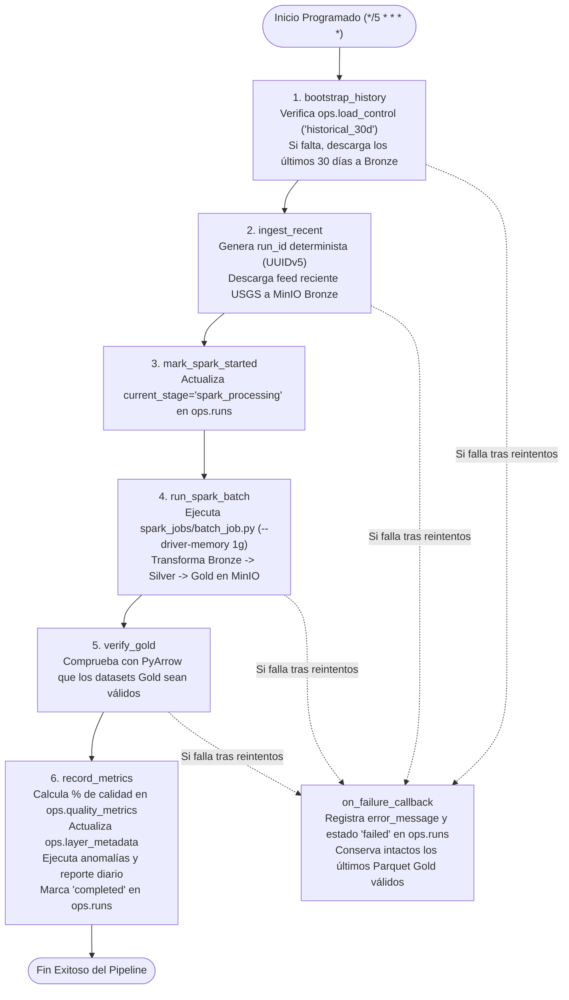
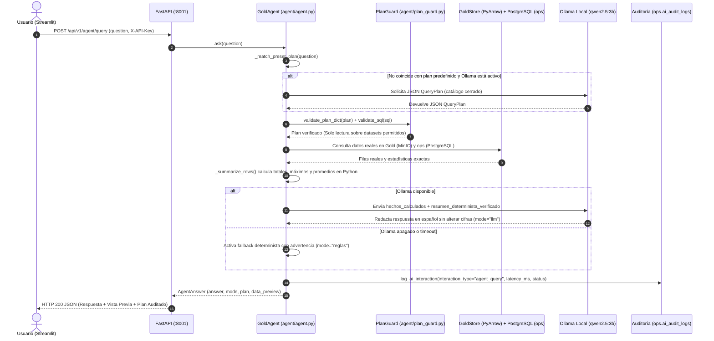
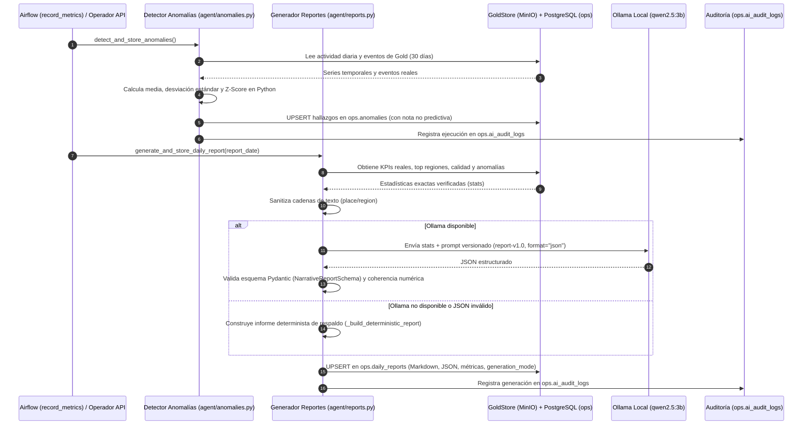

# Flujo de Datos Paso a Paso y Diagramas de Secuencia — SismoWatch

Este documento detalla el recorrido completo de un evento sísmico dentro de la plataforma **SismoWatch**, desde su detección por la red sísmica global del USGS hasta su visualización en el dashboard y su interpretación en el subsistema de Inteligencia Artificial con Ollama. También documenta cómo el sistema maneja errores, reintentos e idempotencia sin perder los últimos datos válidos.

---

## 1. El Recorrido de un Evento Sísmico (10 Etapas)

### Etapa 1: Publicación en la Fuente (USGS)
1. Un evento sísmico ocurre en cualquier parte del mundo y es registrado por las estaciones sismológicas del **United States Geological Survey (USGS)**.
2. El catálogo oficial (`earthquake.usgs.gov`) actualiza sus feeds GeoJSON públicos (`all_hour.geojson`) y expone su API FDSN (`fdsnws/event/1/query`) para ventanas históricas.
3. Cada sismo recibe un identificador único global (`feature.id`, por ejemplo `us6000p9xy`), junto con sus coordenadas (`[longitud, latitud, profundidad_km]`), magnitud (`mag`), tipo de magnitud (`magType`), lugar (`place`), timestamp en milisegundos UTC (`time`), timestamp de actualización (`updated`) y bandera de tsunami (`tsunami`).

### Etapa 2: Obtención de Registros (Módulo de Ingesta Python)
1. El cliente [`ingest/usgs_client.py`](file:///home/cohorte5/Documentos/Prueba_Kevin/ingest/usgs_client.py) realiza una petición HTTP `GET` con sesión resiliente (`urllib3.util.retry.Retry`, hasta 3 reintentos exponenciales con `backoff_factor=1.0`).
2. Existen dos flujos de captura:
   - **Carga histórica inicial (30 días):** ejecutada por [`ingest/ingest_historical.py`](file:///home/cohorte5/Documentos/Prueba_Kevin/ingest/ingest_historical.py) cuando `ops.load_control` aún no registra `historical_30d`.
   - **Carga incremental cada 5 minutos:** ejecutada por [`ingest/ingest_recent.py`](file:///home/cohorte5/Documentos/Prueba_Kevin/ingest/ingest_recent.py) consumiendo el feed reciente.

### Etapa 3: Coordinación y Orquestación (Apache Airflow)
1. El DAG [`dags/sismowatch_batch_dag.py`](file:///home/cohorte5/Documentos/Prueba_Kevin/dags/sismowatch_batch_dag.py) (`dag_id="sismowatch_medallion"`, `schedule="*/5 * * * *"`, `max_active_runs=1`, `catchup=False`) coordina la secuencia completa:
   `bootstrap_history -> ingest_recent -> mark_spark_started -> run_spark_batch -> verify_gold -> record_metrics`.
2. Al iniciar, [`db/runs.py`](file:///home/cohorte5/Documentos/Prueba_Kevin/db/runs.py) deriva un `run_id` determinista mediante `uuid.uuid5(NAMESPACE_URL, f"sismowatch:{airflow_run_id}")` y registra en PostgreSQL (`ops.runs`) el estado `running` y la etapa actual (`current_stage`).
3. Si cualquier tarea falla tras agotarse sus reintentos, Airflow dispara el callback `on_failure_callback` para marcar el `run_id` como `failed` en `ops.runs` conservando intactas las capas Silver y Gold previas.

### Etapa 4: Almacenamiento Crudo en Capa Bronze (MinIO)
1. El módulo [`ingest/storage.py`](file:///home/cohorte5/Documentos/Prueba_Kevin/ingest/storage.py) y [`ingest/paths.py`](file:///home/cohorte5/Documentos/Prueba_Kevin/ingest/paths.py) guardan el GeoJSON original sin alterar ningún campo en el bucket S3 `sismowatch` de MinIO bajo los prefijos:
   - `s3a://sismowatch/bronze/source=usgs/kind=recent/ingest_date=YYYY-MM-DD/`
   - `s3a://sismowatch/bronze/source=usgs/kind=historical/ingest_date=YYYY-MM-DD/`
2. **Propósito:** conservar la evidencia inmutable de lo que reportó el USGS en ese instante exacto, permitiendo reprocesar toda la historia si cambia una regla de negocio.

### Etapa 5: Limpieza, Normalización y Deduplicación (Spark Batch → Silver)
1. Airflow ejecuta `run_spark_batch` lanzando [`spark_jobs/batch_job.py`](file:///home/cohorte5/Documentos/Prueba_Kevin/spark_jobs/batch_job.py) (apoyado en [`spark_jobs/pure.py`](file:///home/cohorte5/Documentos/Prueba_Kevin/spark_jobs/pure.py) y [`spark_jobs/common.py`](file:///home/cohorte5/Documentos/Prueba_Kevin/spark_jobs/common.py)) en el clúster Spark (`spark://spark-master:7077`).
2. Spark lee los archivos GeoJSON de `bronze/` y aplica las reglas de calidad:
   - **Descartes (`invalid_records`):** filtra registros sin `event_id`, sin `event_time`, o con coordenadas/magnitud/profundidad fuera de rangos físicos válidos (`latitud` fuera de `[-90, 90]`, `longitud` fuera de `[-180, 180]`, `magnitud` fuera de `[-2, 10]`, `profundidad` fuera de `[-10, 1000]`).
   - **Normalización:** convierte timestamps epoch en milisegundos a `TIMESTAMP UTC`, deriva la `region` textual a partir de `place` (ej. `"12 km WSW of Pitaloza Arriba, Panama"` → `"Panama"`), y asigna la categoría de magnitud (`magnitude_bucket`).
   - **Deduplicación (`duplicate_records`):** como el feed horario del USGS repite eventos en capturas sucesivas de 5 minutos, Spark aplica una ventana `ROW_NUMBER() OVER (PARTITION BY event_id ORDER BY updated_at DESC, ingest_ts DESC)` y conserva únicamente la versión más reciente de cada `event_id`.

### Etapa 6: Almacenamiento Limpio en Capa Silver (MinIO Parquet)
1. El DataFrame limpio y deduplicado se escribe en formato **Apache Parquet** con compresión Snappy, particionado por `event_date`, en `s3a://sismowatch/silver/events/event_date=YYYY-MM-DD/`.
2. **Propósito:** ofrecer un dataset tipado, comprimido y libre de duplicados para el cálculo analítico.

### Etapa 7: Cálculo Analítico e Indicadores (Spark Batch → Gold)
1. Dentro de [`spark_jobs/batch_job.py`](file:///home/cohorte5/Documentos/Prueba_Kevin/spark_jobs/batch_job.py), Spark calcula a partir de Silver los datasets analíticos de la capa **Gold** y los persiste en MinIO (`s3a://sismowatch/gold/`):
   - `gold/summary/`: KPIs generales (total de eventos, magnitud máxima, magnitud promedio, profundidad media, alertas de tsunami, último evento).
   - `gold/daily_activity/`: serie temporal diaria de conteo de sismos, magnitud máxima y promedio.
   - `gold/magnitude_distribution/`: histograma por rangos de magnitud.
   - `gold/top_places/` y `gold/top_regions/`: rankings geográficos por frecuencia y magnitud máxima.
   - `gold/events/`: eventos enriquecidos listos para el mapa y consultas de detalle.
   - `gold/data_quality/`: conteos exactos de auditoría (`bronze_records`, `valid_records`, `invalid_records`, `duplicate_records`, `silver_records`, `freshness_minutes`).
2. A continuación, la tarea `verify_gold` ([`pipeline/verify_gold.py`](file:///home/cohorte5/Documentos/Prueba_Kevin/pipeline/verify_gold.py)) comprueba con PyArrow que todos los datasets Parquet de Gold existan y sean legibles.

### Etapa 8: Publicación Idempotente de Metadatos, Reportes y Anomalías en PostgreSQL (`ops`)
1. La tarea final `record_metrics` ([`pipeline/record_metrics.py`](file:///home/cohorte5/Documentos/Prueba_Kevin/pipeline/record_metrics.py)) lee `gold/data_quality` desde MinIO y publica de forma transaccional e idempotente (`ON CONFLICT DO UPDATE`) en la base operativa `sismowatch-db` (esquema `ops`):
   - `ops.runs`: actualiza estado `completed`, duración en segundos y conteos procesados.
   - `ops.quality_metrics`: calcula y guarda `quality_percentage = (valid_records - duplicate_records) / bronze_records * 100`.
   - `ops.layer_metadata`: registra el estado, formato (`geojson`/`parquet`), conteo de filas y rutas de las capas `bronze`, `silver` y `gold`.
2. **Automatizaciones post-pipeline:** al cerrarse `record_metrics`, se ejecutan automáticamente:
   - La **detección estadística de anomalías** ([`agent/anomalies.py`](file:///home/cohorte5/Documentos/Prueba_Kevin/agent/anomalies.py) → `ops.anomalies`).
   - La **generación del informe narrativo diario** ([`agent/reports.py`](file:///home/cohorte5/Documentos/Prueba_Kevin/agent/reports.py) → `ops.daily_reports`).

### Etapa 9: Exposición Segura mediante API REST (FastAPI)
1. El backend [`api/app.py`](file:///home/cohorte5/Documentos/Prueba_Kevin/api/app.py) (puerto `8001`) valida el encabezado `X-API-Key` y los permisos de rol (`X-User-Role`) antes de servir datos.
2. Mediante [`pipeline/gold_store.py`](file:///home/cohorte5/Documentos/Prueba_Kevin/pipeline/gold_store.py) y [`api/queries.py`](file:///home/cohorte5/Documentos/Prueba_Kevin/api/queries.py), la API lee los Parquet Gold desde MinIO con **PyArrow** y los metadatos operativos/IA desde PostgreSQL (`ops`). El navegador nunca recibe credenciales de MinIO ni de la base de datos.

### Etapa 10: Visualización en Dashboard y Redacción con Ollama
1. **Dashboard Streamlit ([`dashboard/app.py`](file:///home/cohorte5/Documentos/Prueba_Kevin/dashboard/app.py)):** consume exclusivamente la API REST y presenta el mapa interactivo MapLibre, los KPIs, las series de evolución, el ranking de zonas/regiones, la calidad de datos, el agente conversacional, los reportes/anomalías y el monitoreo del pipeline.
2. **Agente de IA ([`agent/agent.py`](file:///home/cohorte5/Documentos/Prueba_Kevin/agent/agent.py) + Ollama `qwen2.5:3b`):** valida un plan de consulta de solo lectura con [`agent/plan_guard.py`](file:///home/cohorte5/Documentos/Prueba_Kevin/agent/plan_guard.py), calcula las estadísticas exactas en Python sobre Gold/`ops` y solicita a Ollama redactar la explicación en español sin alterar ni inventar cifras.

---

## 2. Diagrama del Proceso ETL y Capas Medallion

```mermaid
flowchart LR
    subgraph Fuente["1. Fuente Externa"]
        USGS["API GeoJSON USGS"]
    end

    subgraph Bronze["2. Capa Bronze (MinIO)"]
        B_JSON["GeoJSON Crudo Inmutable\ns3a://sismowatch/bronze/\n(2,234 registros leídos)"]
    end

    subgraph Silver["3. Capa Silver (Spark -> MinIO)"]
        S_CLEAN["Validación de Rangos\nNormalización UTC y Región\nDeduplicación por event_id"]
        S_PARQUET["Parquet + Snappy\ns3a://sismowatch/silver/events/\n(2,016 sismos únicos)"]
    end

    subgraph Gold["4. Capa Gold (MinIO) y Operativo (PostgreSQL ops)"]
        G_AGG["Agregación Analítica\nsummary, daily_activity,\ntop_regions, data_quality"]
        G_MINIO["Parquet Analítico Gold\ns3a://sismowatch/gold/"]
        G_PG["PostgreSQL Esquema ops\nruns, quality_metrics,\nlayer_metadata, anomalies,\ndaily_reports, ai_audit_logs"]
    end

    USGS -->|"ingest_recent.py / ingest_historical.py"| B_JSON
    B_JSON -->|"spark_jobs/batch_job.py"| S_CLEAN
    S_CLEAN --> S_PARQUET
    S_PARQUET -->|"spark_jobs/batch_job.py"| G_AGG
    G_AGG --> G_MINIO
    G_MINIO -->|"verify_gold.py + record_metrics.py"| G_PG
```

---

## 3. Diagrama de Ejecución del DAG de Apache Airflow (`sismowatch_medallion`)

El DAG se ejecuta cada 5 minutos con la siguiente cadena de tareas y callbacks de protección:

---

## 4. Diagrama de Secuencia: Consulta del Agente Conversacional de IA

Muestra la interacción exacta desde que el usuario escribe una pregunta en la pestaña **Agente IA** hasta que recibe la respuesta explicada y auditada:

---

## 5. Diagrama de Secuencia: Reporte Narrativo Diario y Detección de Anomalías

Muestra cómo operan las dos automatizaciones de IA al cerrarse `record_metrics` o cuando un usuario autorizado (`admin`/`analyst`/`operator`) solicita su ejecución:

---

## 6. Tolerancia a Fallos, Reintentos y Conservación de Datos Válidos

| Escenario de Fallo | Cómo responde SismoWatch | Cómo se protegen los últimos datos válidos |
| :--- | :--- | :--- |
| **Caída temporal de la API del USGS** | `usgs_client.py` realiza 3 reintentos con espera exponencial. Si continúa caída, Airflow reintenta la tarea y luego marca el `run_id` como `failed`. | No se escribe ningún archivo corrupto en `bronze/`, y los Parquet de `silver/` y `gold/` conservan intactos los datos de la última ejecución exitosa. |
| **Fallo o falta de memoria en un Job de Spark** | Airflow detecta el código de salida distinto de cero, aplica límite de memoria (`--driver-memory 1g --executor-memory 1g`) y, si falla, ejecuta `on_failure_callback`. | La verificación `verify_gold.py` detiene el flujo antes de `record_metrics.py` si algún dataset Gold está incompleto, manteniendo consistente el estado operativo en `ops`. |
| **Re-ejecución manual de un DAG pasado** | `db/runs.py` genera el mismo `run_id` determinista (`UUIDv5`) y actualiza la fila existente (`ON CONFLICT (run_id) DO UPDATE`). | En `ops.runs`, `ops.quality_metrics`, `ops.layer_metadata`, `ops.anomalies` y `ops.daily_reports` se utilizan claves únicas con `ON CONFLICT DO UPDATE`, garantizando idempotencia total sin duplicar registros. |
| **Caída o desconexión de Ollama** | El bloque `try/except` de `agent/agent.py` y `agent/reports.py` captura el error de red o timeout. | El agente responde en milisegundos usando su motor determinista (`mode="reglas"`) y el generador de informes construye el reporte estructurado en modo `fallback`, registrando el incidente en `ops.ai_audit_logs`. |
