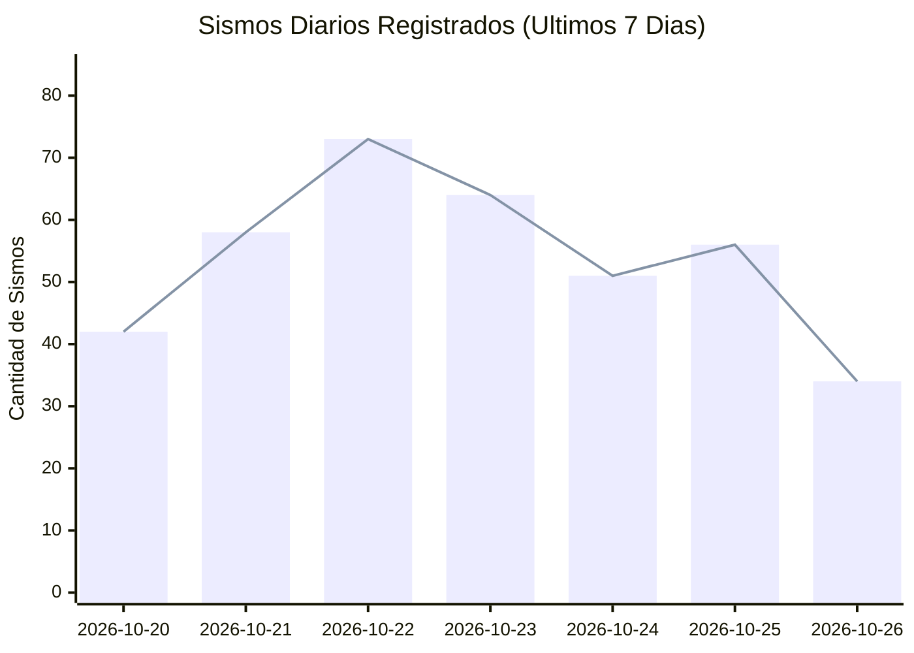
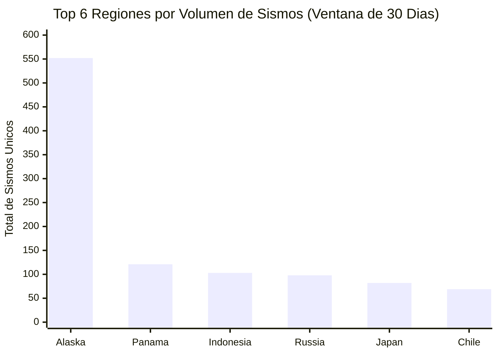
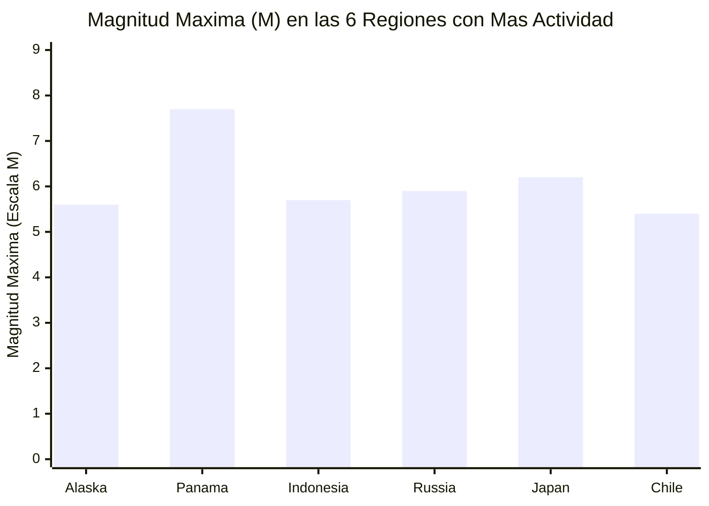

# Indicadores Clave (KPIs) y Catálogo de Gráficos — SismoWatch

Este documento explica en detalle cada indicador clave de desempeño (KPI) y cada visualización del dashboard de **SismoWatch** ([`dashboard/app.py`](file:///home/cohorte5/Documentos/Prueba_Kevin/dashboard/app.py)), incluyendo sus fórmulas matemáticas exactas, unidades de medida, orígenes de datos en la capa **Gold** (MinIO Parquet) y en **PostgreSQL (`esquema ops`)**, ejemplos numéricos reales verificados en el sistema y su interpretación operativa.

---

## 1. Catálogo de Indicadores Clave (KPIs)

### 1.1. Total de Eventos en las Últimas 24 Horas (`events_last_24h`)
- **Qué mide:** La cantidad de sismos únicos registrados a nivel global durante las últimas 24 horas móviles respecto al último evento disponible en la capa Gold.
- **Fórmula matemática:**
  $$\text{Eventos}_{24\text{h}} = \left| \left\{ e \in \text{gold/events} \;\middle|\; e.\text{event\_time} \ge \max(\text{event\_time}) - 24\text{ horas} \right\} \right|$$
- **Unidad de medida:** Conteo entero de eventos (`sismos`).
- **Origen de los datos:** Dataset Parquet `s3a://sismowatch/gold/events/` leído con PyArrow a través de [`api/queries.py`](file:///home/cohorte5/Documentos/Prueba_Kevin/api/queries.py).
- **Ejemplo numérico real del proyecto:** **`58 sismos`** en las últimas 24 horas, con una magnitud máxima de **`M5.80`** (`196 km NW of Port-Olry, Vanuatu`).
- **Interpretación:**
  - **Valor alto (> 80 sismos/día):** Incremento en la actividad sísmica global o presencia de una secuencia de réplicas tras un sismo mayor.
  - **Valor normal (30 – 75 sismos/día):** Actividad sísmica base esperada para el umbral de magnitud configurado (`minmagnitude=2.5`).
  - **Valor cero (`0`):** Posible retraso en el pipeline de ingesta o interrupción en el feed del USGS (debe verificarse el indicador de frescura en la pestaña *Calidad* o *Monitoreo*).
- **Dónde se muestra:** Pestaña **Resumen** (segunda fila de tarjetas KPI) y pestaña **Agente IA**.

---

### 1.2. Total de Eventos en la Ventana Analítica de 30 Días (`total_events`)
- **Qué mide:** El volumen total acumulado de eventos sísmicos únicos y validados en los últimos 30 días.
- **Fórmula matemática:**
  $$\text{Total}_{30\text{d}} = \left| \left\{ e \in \text{gold/events} \;\middle|\; e.\text{event\_time} \ge t_{\text{actual}} - 30\text{ días} \right\} \right|$$
- **Unidad de medida:** Conteo entero de eventos (`sismos`).
- **Origen de los datos:** Dataset `gold/summary/` y `gold/events/` (`GET /api/v1/summary`).
- **Ejemplo numérico real del proyecto:** **`2,016 sismos`** únicos validados en la ventana de 30 días (`1,998` en el corte inicial de bootstrap).
- **Interpretación:** Permite dimensionar el tamaño de la muestra estadística sobre la cual se calculan los promedios, rankings regionales y umbrales de anomalías.
- **Dónde se muestra:** Pestaña **Resumen** (primera tarjeta de la fila superior: `Total sismos`).

---

### 1.3. Magnitud Máxima (`max_magnitude`) y Magnitud Promedio (`avg_magnitude`)
- **Qué miden:**
  - **Magnitud máxima:** El valor más alto de liberación de energía sísmica registrado en la ventana consultada.
  - **Magnitud promedio:** La media aritmética de las magnitudes de todos los eventos válidos del periodo.
- **Fórmulas matemáticas:**
  $$M_{\max} = \max_{i=1 \dots N} (m_i) \qquad , \qquad \overline{M} = \frac{1}{N} \sum_{i=1}^{N} m_i$$
- **Unidad de medida:** Escala de magnitud reportada por el USGS (`M`, adimensional en escala logarítmica).
- **Origen de los datos:** Datasets Parquet `gold/summary/` y `gold/daily_activity/`.
- **Ejemplo numérico real del proyecto:**
  - **Magnitud máxima (30 días):** **`M7.70`** (registrado en `12 km WSW of Pitaloza Arriba, Panama`, profundidad `12.6 km`).
  - **Magnitud promedio (30 días):** **`M3.88`**.
- **Interpretación:**
  - **$M_{\max} \ge 6.0$:** Sismo fuerte o mayor con potencial destructivo local o regional; activa la detección de anomalías por pico de magnitud.
  - **$\overline{M}$ entre `3.5` y `4.3`:** Comportamiento estadístico normal del catálogo con corte en `M2.5`.
- **Dónde se muestran:** Pestaña **Resumen** (`Magnitud máxima` y `Magnitud promedio`) y gráfico de tendencia diaria en la pestaña **Evolución**.

---

### 1.4. Eventos con Alerta de Tsunami (`tsunami_events`)
- **Qué mide:** El número de eventos sísmicos que tuvieron activa la bandera oficial `tsunami = 1` en el boletín del USGS (sismos oceánicos o costeros con potencial tsunamigénico).
- **Fórmula matemática:**
  $$\text{Alertas Tsunami} = \sum_{i=1}^{N} \mathbb{I}(\text{tsunami}_i = 1)$$
- **Unidad de medida:** Conteo entero de eventos (`alertas`).
- **Origen de los datos:** Columna `tsunami` en `gold/summary/` y `gold/events/`.
- **Ejemplo numérico real del proyecto:** **`4 alertas de tsunami`** en la ventana de 30 días (`0` en las últimas 24 horas).
- **Interpretación:**
  - **Valor `> 0`:** Indica que al menos un evento costero/submarino requirió boletín de seguimiento oceánico.
  - **Valor `0`:** Ningún sismo del periodo activó protocolos de tsunami.
- **Dónde se muestra:** Pestaña **Resumen** (tarjeta `Alertas de tsunami`) y reporte narrativo diario.

---

### 1.5. Regiones y Zonas con Mayor Actividad Sísmica (`top_regions` y `top_places`)
- **Qué mide:** El ranking de regiones y ubicaciones específicas ordenadas de mayor a menor según su frecuencia sísmica acumulada en los últimos 30 días, acompañado de su magnitud máxima y magnitud promedio.
- **Fórmula matemática:**
  $$\text{Eventos}(R) = \left| \left\{ e \in \text{gold/events} \;\middle|\; e.\text{region} = R \right\} \right|$$
- **Unidad de medida:** Eventos por región (`sismos`) y magnitud (`M`).
- **Origen de los datos:** Datasets Parquet `gold/top_regions/` (`GET /api/v1/top-regions`) y `gold/top_places/` (`GET /api/v1/top-places`).
- **Ejemplo numérico real del proyecto (Top 5 regiones verificado):**
  1. **Alaska:** `552 sismos` ($M_{\max} = 5.60$, $\overline{M} = 3.21$).
  2. **Panama:** `121 sismos` ($M_{\max} = 7.70$, $\overline{M} = 4.21$).
  3. **Indonesia:** `103 sismos` ($M_{\max} = 5.70$, $\overline{M} = 4.53$).
  4. **Russia:** `98 sismos` ($M_{\max} = 5.90$, $\overline{M} = 4.46$).
  5. **Japan:** `82 sismos` ($M_{\max} = 6.20$, $\overline{M} = 4.56$).
- **Interpretación:** Refleja la concentración de actividad en el Cinturón de Fuego del Pacífico y permite identificar secuencias regionales activas (como las réplicas en Panamá tras el evento M7.7).
- **Dónde se muestra:** Pestañas **Regiones**, **Zonas** y **Agente IA**.

---

### 1.6. Porcentaje de Calidad de Datos (`quality_percentage`) y Registros Aprobados/Descartados
- **Qué mide:** La proporción de registros únicos y válidos que superan las reglas de validación y deduplicación frente al total de registros crudos leídos en la capa Bronze.
- **Fórmula matemática implementada en [`pipeline/record_metrics.py`](file:///home/cohorte5/Documentos/Prueba_Kevin/pipeline/record_metrics.py):**
  $$\text{Calidad (\%)} = \max\left(0,\; \min\left(100,\; \frac{\text{valid\_records} - \text{duplicate\_records}}{\text{bronze\_records}} \times 100\right)\right)$$
  Donde:
  - $\text{bronze\_records}$: total de registros crudos leídos desde MinIO Bronze.
  - $\text{invalid\_records}$: registros descartados por coordenadas, magnitud o identificador fuera de rango.
  - $\text{duplicate\_records}$: registros repetidos del mismo `event_id` entre snapshots sucesivos del feed horario.
  - $\text{valid\_records} = \text{bronze\_records} - \text{invalid\_records}$.
  - $\text{silver\_records} = \text{valid\_records} - \text{duplicate\_records}$ (eventos únicos finales en Silver/Gold).
- **Unidad de medida:** Porcentaje (`%`, de `0.00%` a `100.00%`) y conteo de filas (`registros`).
- **Origen de los datos:** Tabla `ops.quality_metrics` y dataset `gold/data_quality/` (`GET /api/v1/metadata/quality` y `GET /api/v1/metadata/summary`).
- **Ejemplo numérico real del proyecto:**
  - **Ejecución inicial de carga (bootstrap):** `2,033` leídos en Bronze, `0` inválidos, `35` duplicados → `1,998` únicos en Silver → **Calidad = `98.28%`**.
  - **Ejecución incremental acumulada:** `2,234` leídos en Bronze, `0` inválidos, `218` duplicados (debido al solapamiento normal del feed horario cada 5 min) → `2,016` únicos en Silver → **Calidad = `90.24%`**.
- **Interpretación:**
  - **Invalid records = `0`:** Confirma que el esquema del USGS no presenta corrupción estructural.
  - **Duplicate records > `0`:** Es un comportamiento esperado y saludable en ingestas de 5 minutos sobre un feed de 60 minutos; demuestra que la ventana de deduplicación de Spark evita que el dashboard infle artificialmente el número de sismos.
- **Dónde se muestra:** Pestañas **Resumen**, **Calidad** y **Monitoreo**.

---

### 1.7. Frescura de los Datos y Última Actualización (`freshness_minutes` / `last_data_update`)
- **Qué mide:** El tiempo transcurrido en minutos desde el último evento sísmico registrado (`last_event_time`) y la marca de tiempo de la última ejecución exitosa del pipeline (`finished_at`).
- **Unidad de medida:** Minutos (`min`) y fecha/hora en estándar ISO-8601 (`UTC`).
- **Origen de los datos:** Tablas `ops.runs`, `ops.quality_metrics` y `ops.layer_metadata`.
- **Interpretación:** Si la diferencia entre la hora actual y `finished_at` supera los 10 minutos (dos ciclos del DAG de 5 minutos), indica que el scheduler de Airflow está detenido o que una tarea está en reintento.
- **Dónde se muestra:** Pestañas **Calidad** y **Monitoreo**.

---

### 1.8. Duración y Estado de las Ejecuciones de Airflow (`duration_seconds`, `status`)
- **Qué mide:** El tiempo total empleado por el pipeline desde su inicio hasta `record_metrics` (o `on_failure_callback`) y su resultado operativo (`completed`, `failed`, `running`).
- **Fórmula matemática:**
  $$\text{Duración (s)} = \text{EXTRACT(EPOCH FROM } (\text{finished\_at} - \text{started\_at})\text{)}$$
- **Unidad de medida:** Segundos (`s`).
- **Origen de los datos:** Tabla `ops.runs` (`GET /api/v1/metadata/runs` y `GET /api/v1/runs`).
- **Ejemplo numérico real del proyecto:** Duraciones típicas entre **`18 s` y `45 s`** por lote incremental de 5 minutos.
- **Dónde se muestra:** Pestañas **Calidad** y **Monitoreo** (gráfico de barras de duración por corrida coloreado por estado y tabla de historial de ejecuciones).

---

### 1.9. Conteo de Anomalías Estadísticas y Puntaje Z (`Z-Score`)
- **Qué mide:** La cantidad de eventos o agregados diarios que se desvían significativamente del comportamiento histórico de los últimos 30 días.
- **Fórmulas matemáticas implementadas en [`agent/anomalies.py`](file:///home/cohorte5/Documentos/Prueba_Kevin/agent/anomalies.py):**
  1. **Z-Score de frecuencia diaria:**
     $$Z = \frac{x - \mu}{\sigma}$$
     Se marca anomalía cuando $Z \ge 2.0$ con un mínimo de períodos base verificados.
  2. **Pico de magnitud (`magnitude_spike`):** Cualquier sismo con magnitud $M \ge 6.0$ (severidad `high`/`critical` según magnitud y Z-Score).
- **Unidad de medida:** Desviaciones estándar ($\sigma$, adimensional) y conteo de hallazgos (`anomalías`).
- **Origen de los datos:** Tabla `ops.anomalies` (`GET /api/v1/anomalies`).
- **Ejemplo numérico real del proyecto:** **`17 anomalías detectadas`** en la ventana de 30 días, encabezadas por el sismo de **`M7.70`** en Panamá y el día `2026-10-10` con **`141 sismos`** frente a una media diaria de `65.1` ($Z = 2.66$).
- **Dónde se muestra:** Pestaña **Resumen** (tarjeta `Anomalías detectadas`) y pestaña **Agente IA** (sección de anomalías y reportes).

---

## 2. Explicación Detallada de los Gráficos del Dashboard (`dashboard/app.py`)

| # | Nombre del Gráfico | Pestaña | Tipo | Eje X / Eje Y | Colores y Significado | Filtros que lo afectan | Qué conclusión permite obtener y limitaciones |
| :--- | :--- | :--- | :--- | :--- | :--- | :--- | :--- |
| **1** | **Mapa Sísmico Interactivo** | `Mapa` | `px.scatter_map` (MapLibre Dark `carto-darkmatter`) | **Lon / Lat** geográfica | Escala continua por magnitud; tamaño proporcional a magnitud | Región, Lugar/Zona, Magnitud mínima | Permite ubicar epicentros, cordilleras y zonas de subducción en tiempo real con popup detallado. *Limitación:* requiere internet para cargar las teselas cartográficas. |
| **2** | **Distribución por Magnitud** | `Resumen` | Barras (`px.bar`) | **X:** Rango de magnitud (`magnitude_bucket`) **Y:** Cantidad de eventos (`event_count`) | Escala cromática por cubeta de magnitud | Ventana analítica de Gold | Comprueba la ley de Gutenberg-Richter (muchos sismos menores/moderados y pocos sismos fuertes). |
| **3** | **Evolución Diaria del Conteo de Sismos** | `Evolución` | Línea/Área (`px.line` / `px.bar`) | **X:** Fecha (`event_date`) **Y:** Cantidad de sismos (`event_count`) | Cian/Azul sobre fondo oscuro | Ventana de 30 días de la capa Gold | Muestra picos de réplicas o días de alta actividad (ej. 141 sismos el 10 de octubre). |
| **4** | **Tendencia Diaria de Magnitud Máxima y Promedio** | `Evolución` | Líneas dobles (`px.line` con marcadores) | **X:** Fecha (`event_date`) **Y:** Magnitud (`M`) | Dos series: Magnitud máxima diaria (`max_magnitude`) y Magnitud promedio (`avg_magnitude`) | Ventana de 30 días de la capa Gold | Permite comparar la estabilidad del promedio diario (~3.8–4.1) frente a los picos esporádicos de magnitud máxima (M7.7). |
| **5** | **Zonas y Regiones con Mayor Actividad** | `Zonas` / `Regiones` | Barras horizontales (`px.bar`) | **X:** Cantidad de eventos (`event_count`) **Y:** Lugar (`place`) o Región (`region`) | Color según magnitud máxima (`max_magnitude`) | Top lugares / Top regiones de Gold | Identifica rápidamente qué zonas y regiones concentran más sismos y cuáles tuvieron el evento más energético. |
| **6** | **Evolución del % de Calidad de Datos** | `Calidad` | Línea con marcadores (`px.line`) | **X:** Ejecución (`started_at`) **Y:** Calidad (`quality_percentage`, 0–100%) | Verde (`#00d4aa`) | Historial de corridas en `ops.quality_metrics` | Demuestra la estabilidad de la calidad del catálogo y el efecto de la deduplicación entre corridas. |
| **7** | **Duración y Estado de las Ejecuciones del Pipeline** | `Calidad` / `Monitoreo` | Barras (`px.bar`) | **X:** Inicio de corrida (`started_at`) **Y:** Duración en segundos (`duration_seconds`) | Verde para `completed`/`success`, Rojo para `failed` | Historial de `ops.runs` | Permite auditar el rendimiento de Spark/Airflow y verificar cuándo ocurrió un fallo controlado. |

---

## 3. Gráficos Renderizables en Markdown (Datos Reales Verificados)

### 3.1. Actividad Sísmica Diaria en los Últimos 7 Días (`gold/daily_activity`)
Datos reales obtenidos del sistema (`378 sismos` en total durante la última semana):

### 3.2. Top 6 Regiones con Mayor Actividad Sísmica en 30 Días (`gold/top_regions`)

### 3.3. Magnitud Máxima Registrada por Región en el Top 6 (30 Días)

